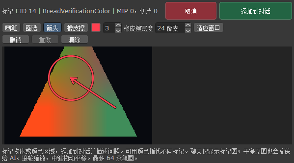
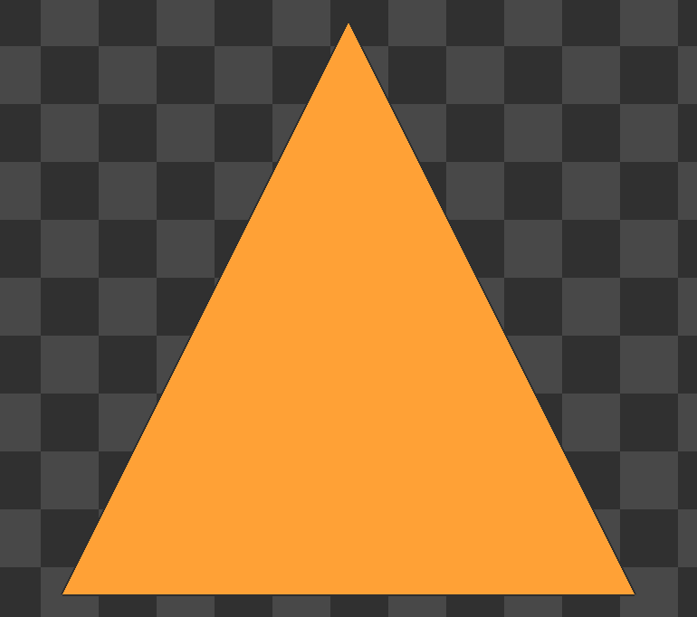
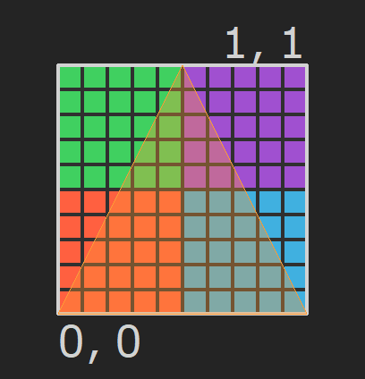
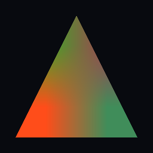
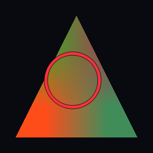

# DF Bread：圈选分析、可视化回复与网格查看器

对应版本 `1.46.142`，上游固定提交 `57a71d58e37fde5b915625a0dd760162c7256f25`。

## 来源与本次更新

本次实际阅读了稻草人的[《RenderDocBread AI新功能—哪里不会圈哪里》](https://zhuanlan.zhihu.com/p/2102853489424713312)，并核对[作者源码仓库](https://github.com/Straw1997/renderdocBread)。文章的两组功能已经包含在本分支此前移植的 `1.46.141` 中。本次更新到 `1.46.142`，补入 Codex 任务隔离修复，重新构建交付程序，并对文章对应功能增加实际验收和操作说明。

`1.46.142` 会在 Bread 的隔离 Codex 任务创建前，识别并以该子进程的启动参数禁用继承的 `node_repl` 服务，重新读取有效配置验证；只有已固定禁用、未暴露工具或服务元数据的条目才可通过工具隔离检查。它不修改用户全局 Codex 配置，也不禁用当前 Codex 桌面应用的工具。

## 1. 在 RT 上圈出问题

1. 运行 `run_bread.ps1`，打开抓帧，选定目标事件和纹理查看器中的渲染目标。先检查 mip、slice、通道与显示范围。
2. 打开 **Bread AI**，点击输入框左侧的画笔图标。该按钮在抓帧已加载时可用。
3. 使用圆圈、箭头或画笔标出区域；可改颜色、用橡皮擦局部擦除、撤销/重做。缩放和平移只改变查看方式，笔画坐标仍对应完整 RT。
4. 点击添加到对话。对话中显示一张标记图，底层同时保存原图、标记图与当时的事件/资源上下文。
5. 输入具体问题，再使用支持图像输入的模型连接发送。点击附件可重新编辑标记；移除附件会一起移除完整配对。

示例问题：

> 分析蓝色圈内的水滴高光由哪些事件和 Shader 计算产生。请引用 EID、资源和关键代码，使用同一事件/附件的前后对比验证判断；最后恢复临时修改，并说明哪些结论仍是推断。

切换事件后，已画好的标记仍绑定原来的快照。不同颜色可以表达不同问题，但要在文字中说清颜色对应的意图。仅有文字能力的连接不能完成这条图像输入链路。

## 2. 阅读可视化回复

回复可以包含以下组件，具体取决于 AI 实际发布的证据：

| 组件 | 使用方法 | 应核对的内容 |
|---|---|---|
| 前后对比图 | 拖动分界线观察变化 | EID、附件、mip/slice、通道和显示范围一致 |
| 流程图 | 查看节点、连线和局部计算 | 节点关联的实际事件和输入输出资源 |
| 代码卡片 | 点击代码位置或相关链接 | 当前工作区、源码版本与行位置匹配 |
| 事件/纹理链接 | 点击回到对应内容 | 当前抓帧与回复引用的抓帧一致 |
| Mesh/UV 图 | 对照几何、UV 与贴图分布 | 是真实捕获证据还是解释性示意图 |

编译成功、ABI 通过和视觉吻合是不同结果。要求 AI 明确记录应用与回滚状态；模型没有完成实际对比时，不应把推导描述成已实证。

## 3. 使用升级后的网格查看器

1. 选择绘制事件，打开网格查看器，选择顶点着色器输入或输出阶段。
2. 点击顶部 **UV**，显示左侧 3D 和右侧 UV。通过 UV 通道下拉框选择实际存在的坐标属性。
3. 点击点、边、面按钮切换组件选择；在 UV 中选择后观察 3D 高亮，也可从 3D 侧选择。
4. 在纹理下拉框选择当前 EID 的输入纹理。RGBA 菜单支持单通道灰度以及通道组合；没有对应输入纹理的 DrawCall 不会凭空出现贴图。
5. 在 UV 视图使用滚轮缩放、中键拖动平移、空格切换纹理平铺。
6. 顶部相机预设支持 **Bread / 3ds Max / Maya**。查看器内的 FOV 控制用于预览，不修改游戏抓帧中的真实投影矩阵。

原有 DF 流水线中的相机诊断入口继续保留，它与网格预览相机是两个功能。

## 4. 实现位置

| 模块 | 源码入口 |
|---|---|
| 画笔入口、附件创建与重新编辑 | `qrenderdoc/Windows/AI/AIAssistant.cpp` |
| 圈选画布、几何坐标、橡皮擦、撤销 | `qrenderdoc/Windows/AI/AITextureAnnotation.cpp` |
| 图像与上下文配对、提供方交付 | `replaylab/src/replaylab_agent/conversation.py` |
| 证据与可视化结果发布 | `replaylab/mcp_host/src/effect_explanations.py`、`visual_replies.py` |
| 对比图、流程图与代码卡片渲染 | `qrenderdoc/Windows/AI/AIVisualReply.cpp` |
| 网格/UV 联动、相机控制 | `qrenderdoc/Windows/BufferViewer.cpp`、`MeshUVView.cpp` |
| 最新 Codex 隔离修复 | `replaylab/src/replaylab_agent/connectors/codex_app_server.py` |

完整进程架构见[工程架构](Bread_DF_工程架构.md)。

## 5. 验证记录

源代码及原生组件测试已通过 226 项，0 失败、0 跳过：134 项 Agent/Qt/可视化测试、83 项效果解释/几何证据测试、9 项真实 Codex 进程配置与生命周期测试。最后一组使用本地模拟模型端点，验证真实 Codex 进程和工具隔离，不代表外部模型已回答问题。

构建已生成 `1.46.142` 原生应用和四个冻结 Host。首次部署遇到测试进程短暂占用 BreadMCP.exe，部署器按预期拒绝覆盖；测试结束后用已有构建产物完成部署，最终运行时验证返回 `valid`。没有终止其他项目的调试窗口。

完整构建和测试日志保存在 `replaylab/output/df-verification-20261124/logs`。实际 UI 和模型连接验收结果记录在下方交付回执中。

### 原生界面与真实回放

交付程序上的 **50 项检查全部通过**，见[原生验收回执](evidence/bread-df-20261124/native-features.json)。覆盖画笔/圆圈/箭头、局部擦除、原图与标记图配对、跨 EID 冻结、附件重开与移除、UV 通道、捕获纹理、RGBA 切换、点/边/面选择同步到 3D 高亮、Maya 导航预设和 FOV 调整。测试抓帧结束后的 SHA-256 与开始时一致。

普通 Qt 窗口截图不能读取原生 GPU 子窗口，因此网格证据使用产品的 `meshEvidence` 接口读取真实预览输出，核对 EID 14、3 个顶点、1 个三角形、纹理 ResourceId 50、TEXCOORD 及选中组件。



| 3D 选中面高亮 | 同一几何的 UV 和捕获纹理 |
|---|---|
|  |  |

### 真实模型调用

交付的冻结 `replaylab-ai.exe` 使用本机已有 Codex 连接完成了真实模型生成、测试 MCP 调用和回执校验，12 项连接诊断全部为 `ok`，见[诊断回执](evidence/bread-df-20261124/model-tool-doctor.json)。

随后在独立 GUI 中完成真实的圈选对话，模型为该连接返回的默认模型 `gpt-6.1-sol`：标记绑定 **EID 14**，发送时界面已切到 **EID 13**；模型正确描述圈内的渐变三角形，通过只读工具核对 ResourceId 48，并返回 EID 14 链接。验收脚本点击该链接后观察到当前事件变为 14。原图和标记图均通过实际图像输入与历史持久化链路。见[模型任务与跳转回执](evidence/bread-df-20261124/native-model.json)、[回复截图](evidence/bread-df-20261124/df-circle-native-answer.png)。

| 实际发送的原图 | 实际发送的标记图 |
|---|---|
|  |  |

本次模型验收的任务是图像理解、只读核对和事件跳转；没有让模型修改游戏 Shader。可视化回复中的对比图、流程图、代码卡片和资源完整性由原生 Qt 及 Host 测试验证。复杂游戏效果的完整自动推导和逐像素还原仍需具体样本验收，不能由这个三角形测试泛化。

测试统计见[test-summary.json](evidence/bread-df-20261124/test-summary.json)，程序哈希及共享扩展哈希见[部署清单](evidence/bread-df-20261124/deployment.json)。共享扩展未修改，原有 DF 补丁反向检查通过，当前 Git HEAD 保持 `32de33ad275ecfc4e8dfe6548ce5955075c0c833`，没有创建提交或推送。

## 6. 复验

在没有其他进程使用该输出目录时，按[使用说明书](Bread_DF_工具使用说明书.md)运行 `build_bread.ps1`。随后可执行：

```powershell
& .\replaylab\output\build-inputs\environment\Scripts\python.exe `
  .\integrations\renderdoc-bread\verification\run_article_features.py `
  --app .\x64\BreadDevelopment\qTinecmaTool.exe `
  --output .\replaylab\output\article-feature-retest.json
```

这个验收在系统临时目录生成自己的两次绘制与纹理抓帧，使用隔离的 UI 配置，测试圈选附件和真实 Mesh/UV 界面，不发送外部模型请求。执行模型测试应使用已登录的连接，并单独记录结果。
