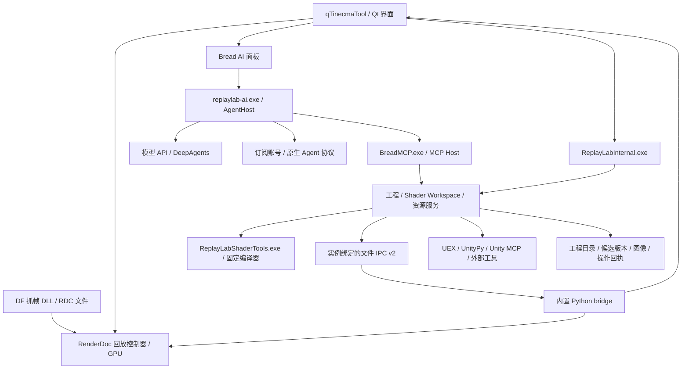

# DF + RenderDocBread 工程架构

本分支已更新到 RenderDocBread `1.46.142`，保留 DF 原有抓帧和应用标识。来源与固定提交见 [UPSTREAM.md](../integrations/renderdoc-bread/UPSTREAM.md)。初次集成验证见[历史报告](Bread_DF_验证报告_2026-11-16.md)，圈选分析、可视化回复与网格升级见[本次更新](Bread_DF_圈选分析与网格查看器_2026-11-24.md)。

## 1. 进程与数据流

UI 线程拥有窗口、面板和当前选择；GPU 查询与替换在 ReplayController 所属回放线程执行。耗时的模型调用、资产索引、编译和格式转换放在外部进程。桥接通过异步调度衔接两侧，避免让模型或磁盘扫描直接占住 UI 线程。

## 2. 目录职责

| 源码位置 | 职责 |
|---|---|
| `renderdoc/driver/{d3d11,d3d12,vulkan,gl}` | 抓帧/回放、资源反射、Shader/CBuffer 覆盖、回放检查点 |
| `renderdoc/api/replay` | C++/Python 共用回放接口与数据类型 |
| `renderdoc/os/win32`、`renderdoccmd`、`renderdocshim` | 保留的 DF Windows 启动、注入和进程兼容实现 |
| `qrenderdoc/Windows`、`qrenderdoc/Widgets` | Shader、纹理、Mesh/UV、流水线、标注、AI 界面 |
| `qrenderdoc/Code/ReplayLab` | UI 与内置集成连接、CBuffer 别名、AI 附件 |
| `qrenderdoc/Code/pyrenderdoc` | SWIG Python 绑定、模块别名、扩展与内置集成加载 |
| `replaylab/src/replaylab_agent` | 模型连接、DeepAgents/原生协议、任务、凭据、能力管理 |
| `replaylab/mcp_host/src` | MCP 工具、工程目录、资源导出、Shader Workspace、证据校验 |
| `replaylab/renderdoc_mcp_bridge` | 在 GUI 内运行的 Python 3.6 桥接，调用真实 UI/回放 API |
| `replaylab/unity` | Unity 资源恢复与编辑器集成代码 |
| `.agents/skills`、`replaylab/portable_skills` | 随应用交付的工作流及工具适配说明 |
| `replaylab/dependencies` | 分片封存输入、SHA-256 清单、Python/.NET 依赖锁 |
| `replaylab/packaging`、`util/i18n` | 可验证运行时构建、部署、翻译检查 |
| `integrations/renderdoc-bread/verification` | 本次新增的真实 D3D11、Shader、CBuffer、Unity 验证用例 |

## 3. 两套 MCP 的区别

**原有全局 RenderDoc MCP**：Codex 连接的 `renderdoc` 服务，GUI 扩展位于 `%APPDATA%\qTinecmaTool\extensions\renderdoc_mcp`。本机扩展含 PySide/别名等兼容修改，不属于普通构建要覆盖的目录。继续遵守“先 ping，再确定抓帧”的工作方式。

**Bread 内置 MCP/bridge**：桥接固定部署到应用旁的 `integrations/replaylab/python/renderdoc_mcp_bridge`；外部 Host 位于 `replaylab/BreadMCP.exe`。它通过 `%LOCALAPPDATA%\ReplayLab\ipc-v2\instances\<pid>-<uuid>` 的请求/响应文件与具体 GUI 通信。`REPLAYLAB_INSTANCE_ID` 可固定目标，避免多个窗口串台。抓帧生命周期还由 `captureSessionId` 隔离。

内置桥接不是用户扩展，不需要复制成 `extension.json` 扩展，也不应通过覆盖全局 `renderdoc_mcp` 来安装。

## 4. Shader 修改链路

1. 从确定的 EID、stage 和 ResourceId 导出真实字节码、反射与目录身份。
2. Workspace 保存不可变基线、来源清单和工具哈希；从已验证路由得到可编辑 HLSL/GLSL/IR。
3. 编辑源码并编译为独立候选版本。编译成功只说明候选可生成。
4. 临时构建目标 Shader，核对原始字节、入口、阶段、资源绑定、常量布局等 ABI；释放临时对象。
5. 应用时再次核对抓帧、源码版本和候选哈希，再执行事件级或资源级替换；返回拥有者和回滚标识。
6. 对同一 EID/附件/显示范围保存前后图像，确认实际像素变化；回滚只清理本次操作拥有的资源。

非 main 入口在本次移植中贯穿 3DMigoto 输出、固定编译器和反射验证。没有放宽 ABI 校验。重建源码的“可编译”不等于与原程序语义一致，工具保留这个区别。

## 5. CBuffer、工程和资源

CBuffer 编辑先获取反射叶字段、绑定窗口、原始数据哈希和布局哈希，再提交字段补丁。版本和快照必须匹配；可恢复原始绑定。显示别名与真实字节布局分离。

工程服务保存抓帧关联、资产索引、Shader 工作区、资源恢复信息和操作回执。资源查找优先依赖字节码/布局/资源证据，名称和 AI 推断不直接构成应用授权。帧流程图由实际事件顺序、资源读写与依赖支撑。

UEX 处理其支持的 Unreal 资源，UnityPy 读取 Unity 数据，Unity MCP 连接已安装对应插件的编辑器。它们与“从 RDC 导出 Mesh/纹理”是不同入口；没有游戏资源包或解密信息时，不会凭空补齐源资源。

## 6. 依赖、配置与部署

- 原生：Visual Studio 2022，仓库指定 MSVC 14.44.35207，x64 Development，`/m:2`。
- GUI：随仓库的 Qt 5.9.4 / PySide2，嵌入 Python 3.6。
- AI/MCP：锁定的外部 Python 3.12 环境；当前构建 Python 3.12.13、PyInstaller 6.22.2。两代 Python 不混用。
- UEX：锁定 .NET SDK 10.0.302、运行时 10.0.10，自包含发布；依赖从仓库封存的 NuGet 输入恢复。
- 原生应用：`x64/BreadDevelopment/qTinecmaTool.exe`；保留 `TinecmaTool.dll`、cmd/shim 和 qTinecmaTool 用户目录。
- AI profile：`%APPDATA%\ReplayLab\ai\profiles.json`；API 密钥使用 Windows 凭据管理器。
- Agent 配置/任务：`%LOCALAPPDATA%\ReplayLab\config`、`%LOCALAPPDATA%\ReplayLab\ai-tasks`。
- 编译器与能力：应用 `replaylab/tools`；首次按需展开的 provider 组件受封存清单约束。

`build_bread.ps1` 执行依赖恢复、翻译检查、原生与绑定编译、冻结四个 Host、SHA-256 部署验证、标准能力和 Unity MCP/UEX 部署。输出目录有活动进程时会拒绝覆盖；不终止用户进程，不修改共享 MCP，不做 Git 提交或发布。

本地 DF 构建没有上游标准便携包的升级标记，不会被识别为可自动安装上游更新的版本。后续升级应固定新上游提交、重新处理 DF 冲突并重跑验证，不能直接用作者 ZIP 覆盖。

## 7. RT 圈选、可视化回复与网格联动

`AIAssistant` 的画笔入口从 TextureViewer 读取当前显示的 RT，`AITextureAnnotation` 保存不可变原图与独立标记层。附件配对保存抓帧会话、观察 EID、ResourceId、mip/slice/sample、显示范围，以及归一化笔画坐标；切换事件不会把旧标记重新解释成新事件的标记。`replaylab_agent/conversation.py` 校验两张图和上下文的一致性，并通过提供方的图像输入通道送入模型。

效果分析通过捕获数据、Shader 工作区和图像证据建立结论；Host 的 `effect_explanations.py`、`visual_replies.py` 处理可视化结果，`AIVisualReply` 呈现前后对比、流程图、代码卡片和 Mesh/UV 内容。事件、资源和代码链接回到实际捕获或工作区。流程图和结论是否正确仍取决于任务实际获得的证据，界面能渲染卡片不代表已验证模型推导。

`BufferViewer::SetupMeshUV` 将原生 3D 回放视图与 `MeshUVView` 并排组织，共享顶点/三角形与组件选择；UV、表格、3D 高亮相互同步。纹理来源为当前 EID 的真实输入绑定，通道过滤有缓存失效处理。Bread/3ds Max/Maya 导航预设和 FOV 属于查看器相机配置，不改写捕获中的游戏相机参数。
