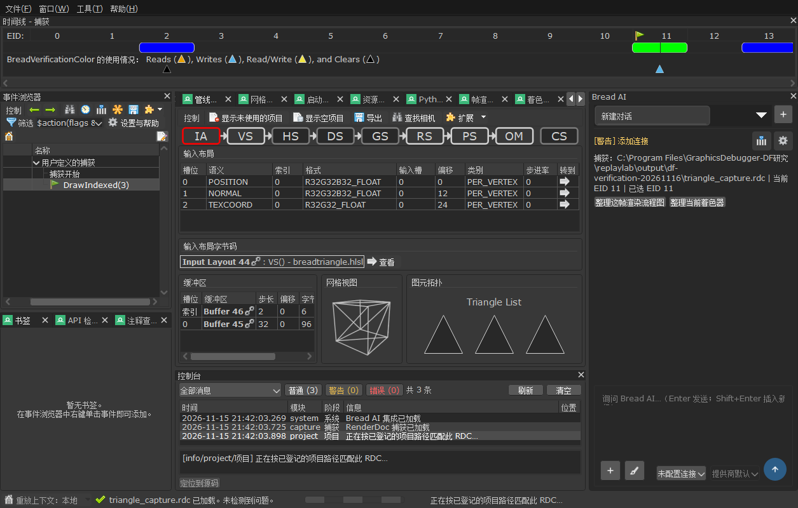
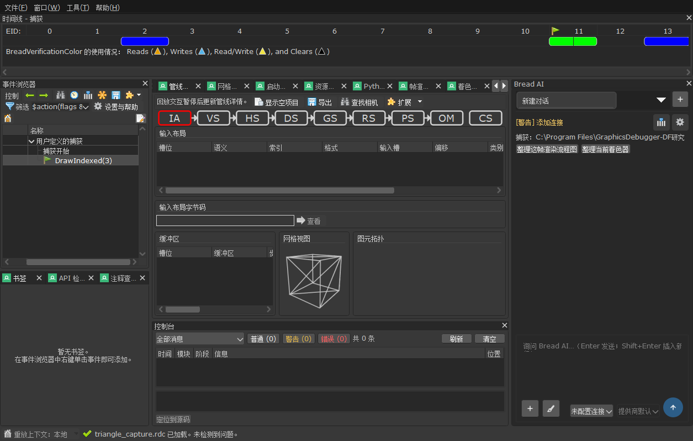

# DF + RenderDocBread 验证报告（2026-11-16）

## 范围与结论

基于原作者 `Straw1997/renderdocBread` 提交 `943d83c5ecdce036b788bf2ea1a338ea4e10740b`，将 `1.46.141` 源码移入本地 `DF研究` 分支。完整来源与文章访问限制见 [UPSTREAM.md](../integrations/renderdoc-bread/UPSTREAM.md)。

已经通过真实 D3D11 抓帧、CBuffer 编辑/回滚、Shader 编译/ABI 校验/替换/回滚、Unity OBJ/FBX 导入，以及真实 DF D3D12 抓帧读取。AI/MCP 运行程序已经构建，冻结 MCP 的真实 stdio 通路通过。**本机尚无 AI profile，未完成外部模型登录和真实模型回答验收；不能把本报告理解成所有账号服务已开通。**

## 1. 真实回放证据

测试抓帧由 [capture_triangle.cpp](../integrations/renderdoc-bread/verification/capture_triangle.cpp) 使用本次构建的 `TinecmaTool.dll` 生成，包含 3 个顶点、3 个索引、法线、UV、`TestColor.Tint` 常量和 256×256 输出。使用真实 GPU、真实 ReplayController 与内置 IPC，未用模拟回放替代。

| 项目 | 实际结果 | 证据 |
|---|---|---|
| D3D11 抓帧 | API 开始/结束抓帧成功，生成可打开 RDC | C++ fixture、构建日志 |
| 内置桥接 | ping、抓帧打开、事件/流水线/目录读取成功 | [桥接回执](evidence/bread-df-20261116/cbuffer-frame-export-receipts.json) |
| CBuffer 编辑 | Tint 修改改变实际 PNG；回滚 PNG 与原始 PNG 字节完全一致 | 同上；下方图像 |
| Shader 工作区 | 反编译并保留 `PS` 入口，编译颜色修改候选 | `shader_smoke.py`、编译日志 |
| Shader ABI | 原始字节、入口、阶段和完整物理布局验证通过 | [验证回执](evidence/bread-df-20261116/validate_shader_workspace_candidate.json) |
| Shader 应用 | 当前 EID 替换后像素变化 | [应用回执](evidence/bread-df-20261116/apply_shader_workspace_candidate.json) |
| Shader 回滚 | 清除本次替换后 PNG 与原始 PNG 字节完全一致 | [回滚回执](evidence/bread-df-20261116/rollback_shader_workspace_override.json) |
| 帧流程输入 | 从真实事件读取动作与资源关系 | 桥接回执中的 `get_current_frame_flow_inputs` |
| Mesh 导出 | 实际生成 OBJ、FBX、材质 JSON 与导入脚本 | 桥接回执中的 `export_to_unity` |
| Unity 导入 | Unity 2022.3.62f3 批处理导入 OBJ/FBX；每个 Mesh 的 3 顶点、3 索引、法线和 UV 均通过 | [Unity 回执](evidence/bread-df-20261116/unity-verification.json) |
| 真实 DF 抓帧 | `DF-Wen4.rdc`，D3D12，读取 823 个 Draw/Dispatch | [DF 抓帧回执](evidence/bread-df-20261116/bread-df-real-capture-20261116.json) |
| 冻结 MCP | 最终交付的 `BreadMCP.exe` 真实 stdio 握手，列出 271 个工具，读取最终 GUI 的 D3D11 与 DF D3D12 状态 | [D3D11 回执](evidence/bread-df-20261116/frozen-mcp-final-deployment.json)、[DF 回执](evidence/bread-df-20261116/frozen-mcp-df-final-deployment.json) |
| 全局 MCP 兼容 | 最终 GUI 使用原用户配置和共享扩展，ping 成功；DF 抓帧包含 737 Draw + 86 Dispatch | [全局 MCP 回执](evidence/bread-df-20261116/global-mcp-final-deployment.json) |
| 原生中文界面 | 实际打开抓帧和 Bread AI 面板，原 D3D11「查找相机」控件保留 | [UI 回执](evidence/bread-df-20261116/native-ui.json)、下方截图 |

图像均来自真实回放：

| 原始画面 | CBuffer 修改 | Shader 修改 |
|---|---|---|
|  |  |  |

最终构建的中文界面与 Bread AI 面板（截图中连接尚未配置）：

测试脚本中的图像比较固定 EID、RTV、mip、slice、sample 和 native 显示范围。早期直接调用普通 `save_texture` 观察的是 UI 当前事件，不能证明事件级覆盖；最终改用事件绑定证据接口并通过比较断言。这是验证脚本修正，没有通过改变回放实现来伪造差异。

## 2. 自动化测试

| 运行 | 用例数 | 失败 | 跳过 | 说明 |
|---|---:|---:|---:|---|
| AgentHost 全套首轮 | 1,965 | 5 | 13 | 尚未完成 GUI DLL 部署；一个夹具仍使用旧 API；相机测试默认 DLL 名称不适用于 DF |
| Agent 原生失败项复验 | 5 | 0 | 0 | 完成部署、指定 TinecmaTool.dll、更新夹具后通过 |
| MCP Host 全套首轮 | 10,641 | 65 | 334 | 60 个失败来自同一组旧反射夹具；另有路径、锁竞争及 .NET 版本问题 |
| MCP 相关模块/新增回归复验 | 206 | 0 | 4 | 覆盖原失败项、非 main 入口、D3D 编译器、工具路由和并发任务报告 |

数字记录在 [test-summary.json](evidence/bread-df-20261116/test-summary.json)，包含 JUnit 原始文件 SHA-256。首轮失败与后续复验分别保留，不把复验数量加成“独立新增测试数”。跳过项不是通过；平台/可选依赖测试未补齐全部外部环境。

其他检查：中文目录共 5,819 条有效翻译、5,819 条完成、0 条未完成；含本分支新增的 10 条相机诊断字符串。原有全局 MCP 源码快照的 Python 3.6 语法与 37 个工具注册检查通过。

## 3. 实际修复

1. **应用身份兼容**：保留 qTinecmaTool 可执行文件与用户目录；同一 SWIG 模块增加 qTinecmaTool 别名；部署器和 GUI 查找识别 DF 名称。
2. **构建 Python**：显式使用锁定 Python 3.12，避免优先选中 Windows 商店的 `python3` 占位程序。
3. **中文工程路径**：Qt 5 lupdate 的响应文件改用仓库相对路径，并在仓库目录执行；当前 `GraphicsDebugger-DF研究` 路径下翻译检查通过。
4. **Shader 入口完整链路**：3DMigoto 生成的 main 绑定回捕获入口；FXC 与 D3DCompiler 固定编译路径保留调试入口信息，解决非 main Shader 无法通过严格反射验证的问题。没有降低 ABI 校验标准。
5. **Windows 并发日志锁**：移除加锁前的首字节写入，防止另一个实例已锁定该区域时 flush 报 EACCES；现有多线程合并测试通过。
6. **测试夹具同步**：补齐异步回放接口、ConstantBlock 值复制和 rawBytes 快照；保留生命周期与状态断言。

## 4. 保留与部署

用户原先的三个 D3D11 PipelineStateViewer 修改文件和 `win32_hook.cpp` 修改已包含在新源码中，原补丁反向检查通过。`.workbuddy` 保留。修改前文件备份与导入清单位于本机 `%TEMP%\GraphicsDebugger-DF-before-Bread-20261116`。

源码以白名单复制 2,465 个文件进入当前分支。51 个上游已删除的旧文档/未参与新工程编译的旧配置源文件继续保留，未进行无关清理。没有提交或推送代码。

共享 `%APPDATA%\qTinecmaTool\extensions\renderdoc_mcp\__init__.py` 保持不变，SHA-256：

`C82637E0BEA259211546AE7F9B61DB70C1FE576861C0124508AB20554A614C3F`

新应用默认输出为 `x64\BreadDevelopment`。构建入口是 `build_bread.ps1`，已在当前中文工程路径执行完整构建，退出码为 0；完整构建日志位于本机 `%TEMP%\bread-df-full-build-final-20261116.log`。可执行文件与 Host 的 SHA-256 见 [部署清单](evidence/bread-df-20261116/deployment.json)。

交付目录随后重新生成 D3D11 测试抓帧，并重跑 CBuffer、Shader 与冻结 MCP 的真实调用，分别得到 `LIVE_SMOKE_PASS`、`SHADER_SMOKE_PASS` 和 271 工具握手成功；本文对应回执和像素图已替换为该轮结果。Unity 导入结果来自同一移植源码的前一轮构建。最后用正常用户配置启动交付程序、打开 DF-Wen4.rdc，全局 MCP 与内置 MCP 同时通过；全局 MCP 统计为 737 Draw + 86 Dispatch，与前一轮只读事件统计的 823 个一致。

完整验证产物和测试 XML 保存在本机忽略目录 `replaylab/output/df-verification-20261116`；小型可追溯回执与截图保存在本文链接的 `docs/evidence/bread-df-20261116`。UEX 自包含程序版本命令、原生 codec 加载与真实 zlib 往返均通过，运行时部署验证返回 valid。

## 5. 尚未覆盖的验收

- **AI 真实模型请求**：未配置 profile/登录/密钥，尚未完成。可在 Bread AI 连接设置完成后执行 `doctor --execution-test`。
- **两篇文章逐段对照**：知乎正文访问返回 403；已从作者 GitHub README 确认第一篇来源，第二篇未取得正文。
- **全游戏视觉复刻**：本次验证工具功能，不代表已重建 DF 全场景、复杂材质或全部 DrawCall。真实 DF 抓帧的本次操作为只读打开/读取。
- **所有图形 API 与交互组合**：真实修改测试覆盖 D3D11；DF D3D12 覆盖打开和读取。Vulkan/OpenGL、所有可视化调试交互、复杂资源恢复和 Unity MCP 编辑器联机仍需对应样本/工程验收。
- **UEX 完整游戏解包**：构建与原生 codec 检查可验证本机部署；没有额外指定资源包、版本/密钥时不声称完成整包提取。

因此，代码移植、可重复构建及列明的核心工具链已有实证；账号服务和未列明场景不能笼统称为“全部已跑通”。
