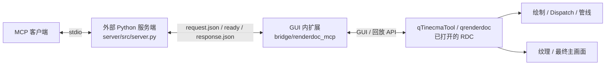

# DF 抓帧分析 MCP：部署与使用

## 摘要

本次使用的 MCP 为 Python 服务端和 GUI 扩展组成的 RenderDocMCP2 快照，源码位于 [integrations/renderdoc-mcp](../integrations/renderdoc-mcp/README.md)。它通过 stdio 接收客户端工具调用，再通过当前用户临时目录下的文件 IPC 请求 GUI 内的 RenderDoc API。DF 捕获本身由 C++ 捕获 DLL 完成；MCP 负责打开 RDC、检查绘制调用、管线和纹理，以及导出结果。

在本次验证中，MCP 已重新打开正式客户端 `zhou1.rdc`，确认 D3D12 frame 67589，统计到 320 个 DrawCall 和 42 个 Dispatch，并导出／查看 Present 对应的 ResourceId 476 主画面。捕获实现、证据与完整链路见 [DF 实现总结](DF_正式客户端截帧_实现总结_2026-10-15.md)。

## 组件与链路



外部服务端需要 Python 3.10+ 和 mcp SDK；GUI 扩展运行在 GUI 自带的 Python/Qt 环境中，不应把外部虚拟环境放入 GUI 的 Python 路径。服务端版本为 1.5.0，扩展清单版本为 1.0.0；两者版本号不同来自现有上游元数据。

## 1. 安装外部服务端

以下以仓库位于 `E:\GraphicsDebugger` 为例，其他路径需替换：

```powershell
Set-Location E:\GraphicsDebugger
py -3 -m venv .\integrations\renderdoc-mcp\.venv
.\integrations\renderdoc-mcp\.venv\Scripts\python.exe -m pip install -e .\integrations\renderdoc-mcp\server
.\integrations\renderdoc-mcp\.venv\Scripts\python.exe -m pip show renderdoc-mcp mcp
```

`py -3` 所选择的 Python 必须满足 3.10+。当前实测环境是 Python 3.12 / mcp 1.30.0；项目约束为 mcp>=1,<2，并不是所有依赖版本组合都已验证。不要复制仓库外原开发机的 `.venv` 或 launcher EXE。

## 2. 安装 GUI 扩展

先关闭需要安装扩展的 GUI，确认其用户配置目录。当前品牌 qTinecmaTool 使用 `%APPDATA%\qTinecmaTool\extensions`，官方 qrenderdoc 的配置目录通常为 `%APPDATA%\qrenderdoc\extensions`。

将 `integrations\renderdoc-mcp\bridge\renderdoc_mcp` 整个目录复制到目标 extensions 下，最终应存在：

```text
<GUI 用户配置目录>/extensions/renderdoc_mcp/
  extension.json
  __init__.py
```

在 GUI 扩展管理界面启用 RenderDoc MCP，并设置需要时随 GUI 启动加载。重启后日志应出现 `[RD-MCP] Poller started` 与 IPC 目录。已有同名扩展时先备份旧的两个文件，再替换；不要把 bridge 外层目录误当成扩展目录。

本次运行的 GUI 扩展与上游快照内的桥接文件已做哈希比对，内容一致。仓库不修改当前机器已安装扩展，也不自动重写用户 UI.config。

## 3. 配置客户端

可参考 [通用 JSON 配置示例](../integrations/renderdoc-mcp/examples/mcp.json)，按客户端格式调整外层配置并替换 `C:/path/to/GraphicsDebugger`。关键字段为：

- command：`<repo>/integrations/renderdoc-mcp/.venv/Scripts/renderdoc-mcp.exe`。
- args：空数组，服务端通过 stdio 运行。
- RENDERDOC_PATH：指向已经构建、可正常启动的 GUI EXE；当前 DF 本机运行包是 `artifacts/graphics-factory-fix/x64/qTinecmaTool.exe`。
- DISABLE_VULKAN_TINECMATOOL_CAPTURE_1_44=1：回放 GUI 不应被当前品牌的全局 Vulkan 捕获层再次注入。

本目录不包含预编译 GUI 或捕获 DLL，运行目录需要按本仓库构建／本机部署获得。不要指向旧目录后误认为它自动包含最新 DF 捕获修复。

## 4. 最小验收流程

1. 启动一个已加载扩展的 GUI。
2. 调用 `ping`，应返回 status=ok。
3. 调用 `open_capture(capture_path=完整RDC路径)`，随后调用 `get_capture_status` 确认 loaded=true 和 API；仅收到 opened 字段不能替代加载状态核验。
4. 调用 `get_draw_calls(include_children=true, only_actions=true)`；按本仓库 ActionFlags 位统计实际绘制。Drawcall=0x0002，Dispatch=0x0004。返回列表的 count 可能包含标记等，不能直接当作 DrawCall 数。
5. 找到最终 Present 输出资源，再调用 `save_texture(resource_id=..., output_path=...)` 并实际查看图像。资源 ID 属于当前 capture，不应把本次的 476 写死用于其他文件。

本次证据为 D3D12 frame 67589、320 DrawCall、42 Dispatch、Present EID 3311、输出 ResourceId 476。详细验收记录见 [df_capture_verified_2026-10-15.json](df_capture_verified_2026-10-15.json)。

仓库还附带可重跑的源码检查脚本：

```powershell
.\integrations\renderdoc-mcp\.venv\Scripts\python.exe .\integrations\renderdoc-mcp\verify.py
.\integrations\renderdoc-mcp\.venv\Scripts\python.exe .\integrations\renderdoc-mcp\verify.py --live
```

默认检查 5 个组件 Python 源文件的语法、扩展的 Python 3.6 语法兼容性以及工具注册；`--live` 进一步依次读取 ping、capture status 和已加载抓帧的动作列表，不会打开新文件或改变选中事件。当前快照实测注册 37 个工具。语法通过不等于每个工具的运行时功能都已验证。

## 5. 兼容改动与已知限制

- GUI 启动适配：先启动 UI，等 bridge，再 IPC 打开 capture。`launched=true` 只表示进程启动，`bridgeReady=false` 也不代表 capture 已打开；应等待 ping 成功后显式 open_capture 并核对 loaded。
- RenderDoc 1.44 的 LoadCapture 使用带 ReplayOptions 的签名；保留旧签名回退但未对所有历史 GUI 版本验证。
- `get_capture_status` / `get_frame_summary` 的 FrameStats 在当前 1.44 绑定中可能是 SWIG 对象字符串而非数字；遇到 stats_note 时，使用动作列表统计，不解析对象地址作为计数。
- 大文件回放耗时不等于失败。超时后先核对现有 GUI、bridge 和加载状态，避免连续新建 GUI。
- IPC 使用当前用户 `%TEMP%/renderdoc_mcp_ipc` 下的固定文件名，没有多实例隔离。一次只让一个 bridge GUI 与一个请求流操作该目录；多实例会有竞争，协议未提供多会话路由。
- 服务端使用 `_err` 返回 JSON 错误，客户端还需检查返回内容，不能只看 MCP 传输是否成功。
- 本次验证覆盖 ping、打开及状态、动作列表、管线查询与纹理导出，不代表服务端的所有工具都经过 DF 场景验证。
- 不要混用根目录旧 C++ MCP zip／适配报告与本目录 Python 服务端的安装步骤。旧材料是历史参考。

## 来源与同步方式

来源及许可证见 [UPSTREAM.md](../integrations/renderdoc-mcp/UPSTREAM.md)。快照保留当前实际工作源码；不包含个人 MCP 配置、凭据、虚拟环境、缓存、抓帧或完整本机日志。相对上游的补丁仅供审阅，安装当前快照不需再应用补丁。
