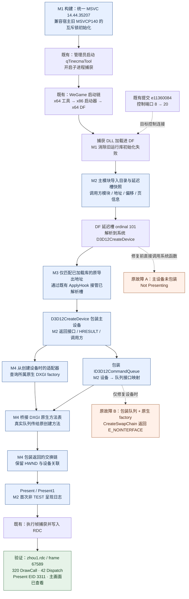

# DF 正式客户端截帧：实现总结与链路图

## 摘要

本轮将 DF 正式客户端从“DLL 已加载、D3D12 Not Presenting、主设备漏捕”，推进到主设备和队列包装、原生 DXGI factory 交换链桥接、Present 捕获及有效 RDC 回放。最终验证文件为本地 `E:\GraphicsDebugger\zhou1.rdc`：已通过 RenderDoc MCP **重新打开**，D3D12 帧号 **67589**，返回动作列表中包含 **320 个 DrawCall、42 个 Dispatch**，最终 Present 为 **EID 3311 / ResourceId 476**。导出并查看该 backbuffer，确认包含 DF 的武器展示主画面和界面，而非空帧或自有测试画面。

关键修复有两处：**M3：接管主模块已解析的 D3D12 延迟导入槽**，修复主设备创建绕过现有包装；**M4：桥接原生 DXGI factory 的交换链创建方法**，解决包装队列传入未包装 factory 时的 `E_NOINTERFACE`，并包装返回交换链以接通 Present。配套完成 **M1：工具链及宿主旧运行库兼容**、**M2：调用方与图形对象链路诊断**。控制端口从 8 个扩展至 20 个的提交此前已在分支中，本轮没有重复实现。

这是一次 Development/x64 配置下、当前 DF 客户端与当前机器环境中的验证结果。不能据此宣称所有客户端版本、显卡、DXGI 路径或反作弊环境均兼容；本轮也未证明 ACE 的 IAT 错误是主设备漏捕原因。

## 完整链路与改动位置

图中 **M1–M4** 为本轮改动；“既有”节点为原有能力；“验证”节点为最终验收。独立图源见 [DF_截帧完整链路.mmd](DF_截帧完整链路.mmd)。

## M1：构建与宿主兼容

文件：`Directory.Build.props`。

- 默认 MSVC 工具集统一为 `14.44.35207`，保留显式 `VCToolsVersion` 覆盖，避免 VS 与命令行构建混用不同版本的共享中间产物。
- 定义 `_DISABLE_CONSTEXPR_MUTEX_CONSTRUCTOR`。宿主已加载 WeGame 自带的旧 MSVCP140 时，避免新式互斥锁初始化路径造成捕获 DLL 加载失败。没有替换 WeGame 的运行库。
- 管理员启动解决了启动链错误 740；这是运行条件，不是新增的权限绕过代码。
- 最终独立运行目录为 `artifacts/graphics-factory-fix/x64/`，避免覆盖被运行进程占用的 DLL。GUI、命令行和 x86 辅助程序沿用配套版本，最新捕获逻辑编入 x64 DLL。

## M2：把判断变成可核对的对象链路

文件：`renderdoc/os/win32/graphics_diagnostics.h`、`win32_hook.cpp`，以及 D3D12/DXGI 包装代码。

- IAT 失败立即保存错误码，输出操作、所属模块、导入函数和 VirtualQuery 页属性；安装与移除失败分别标记，不在失效槽上进行日志解引用。
- 记录图形导出返回了原函数还是包装函数。**返回包装地址不等于函数已实际执行。**
- 设备创建入口记录返回地址对应的模块、模块内偏移、内存类型；无法归属模块的私有内存如实记录为 unknown。
- 两种队列创建接口记录外部设备接口与队列接口映射，避免用内部对象地址错误串联 COM 接口。
- factory、四类交换链创建、交换链包装以及首次非 TEST Present/Present1 记录调用与窗口关联；首次呈现使用原子标志，避免每帧刷日志。
- 主模块普通/延迟导入目录与图形延迟槽仅在初次或变化时记录。读取校验 RVA 和长度，限制描述符与槽数量；读取失败保留诊断。

外部只读检查曾取得进程句柄，但管理员 ReadProcessMemory 读取主模块仍返回 5。该路径停止，没有进一步规避访问限制；后续证据来自捕获 DLL 已有模块扫描中的诊断。

## M3：主设备创建为什么漏捕，如何修复

DF EXE 的普通导入表只指向 `DeltaForceClient-Win64-ShippingBase.dll`；磁盘上的 Base DLL 普通导入只列出 LoadLibraryA。DF 的 D3D12 入口在主 EXE 的延迟导入中，ordinal 101 对应 D3D12CreateDevice。原扫描只处理普通导入表，因此“普通导入形式能抓到”不足以覆盖这条运行时路径。

19:42 诊断版记录了关键变化：

1. 19:43:40，ordinal 101 槽指向 EXE 自身延迟加载跳板。
2. 19:43:53，该槽变成系统 `d3d12.dll+0x65e0`，未指向工具包装入口。
3. 19:43:56.378，游戏记录主设备初始化。该轮工具没有主设备包装记录。

`CachedHookData::ProcessMainDelayImports` 现在检查主模块的 D3D12/DXGI 已解析延迟槽：目标必须精确匹配已加载库中已注册函数的系统导出，才调用既有 ApplyHook。未解析跳板和第三方替换指针保留；不主动加载库或执行延迟解析器，也不改变既有保护失败处理。

受控案例用自身延迟通知回调及原生解析器生成同样的系统函数指针：旧版 capture=0，修复版 capture=1。但这项修复单独应用于 DF 后，引出了下一处不完整包装问题。

## M4：为什么修复设备后游戏反而退出

19:52 的正式客户端日志证明 M3 生效：DF EXE 的设备创建调用进入包装，主设备返回 S_OK，随后创建五个包装队列。19:53:06，游戏创建交换链返回 `E_NOINTERFACE`，报 Fatal error 并调用 RequestExit(1)。这与此前用户请求退出的 RequestExit(0) 不同。

针对性受控案例将**包装队列传给未包装的原生 factory**，稳定复现 CreateSwapChainForHwnd 返回 `0x80004002`。这使修复从“推测未知 IID”转为处理可复现的包装交界。

修复包含三个部分：

1. D3D12CreateDevice 成功返回包装设备且调用方提供适配器时，查询其所属的原生 factory 接口。
2. 对位于系统 dxgi.dll 映像中的原生 factory 方法表桥接四种交换链创建调用。桥保存原方法，识别包装队列后传递真实队列，直接调用原方法以避免递归。
3. 创建成功后使用现有 WrappedIDXGISwapChain4 包装返回对象，接通窗口、Present 与帧捕获。已有包装 factory 向底层传递真实队列时，桥透明转发，避免重复包装。

这是对选定 DXGI 方法表的实际修改，不是只读诊断。已有工具包装表和第三方表不处理；保护修改失败保留失败记录，不增加规避措施。RemoveHooks 恢复仍指向本工具的表项，保留在途调用需要的原始指针，避免覆盖后续第三方改动。

## 验证结果与证据

### 受控回归

- 主模块已解析延迟槽：旧版 capture=0，新版 capture=1，均记录原始输出。
- 原生 factory + 包装队列：旧版 E_NOINTERFACE；修复后的 HWND、传统 CreateSwapChain 和 Composition 三条路径均 capture=1 count=1，并记录首次 Present。
- 原有包装 factory／延迟序号导入回归 capture=1 count=1。
- x64 Development 构建与 git diff --check 通过。
- CoreWindow 没有有效 WinRT 窗口条件，未声称通过。上述 smoke 不包含实际 DrawCall，不能替代 DF 验收。

回归源码、构建脚本与小型日志保存在 `artifacts/iat-diagnostics-test/`；编译产物及测试 RDC 不进入 Git。

### DF 正式客户端

原始日志：`RenderDoc_2026.10.15_20.05.09.log`，游戏 PID **93480**，工具入口 `graphics-factory-fix/x64/qTinecmaTool.exe`。

- 20:06:19：native factory 创建交换链成功，HRESULT=0，HWND=`0x41956`。
- 20:06:21：首次非 TEST Present，设备／窗口关联建立。
- 20:24:30：DF PID 写出 frame 67589 RDC，原临时文件名虽然带 wegame 前缀，进程归属及内容均来自 DF。
- 本地保存：`E:\GraphicsDebugger\zhou1.rdc`，文件大小 **846,740,778 字节**。
- SHA-256：`0417edfa5cc8a8ca59696086e980afa73509363913a5cb1cea867adb98dac194`。
- 重新打开该文件成功，API 为 D3D12，frame 67589。
- 动作列表返回 494 项，其中按 ActionFlags 统计 Drawcall=320、Dispatch=42；494 不是 DrawCall 数。
- EID 205 是实际绘制动作（动作记录 numIndices=4、numInstances=48）；EID 3311 为 Present(ResourceId::476)。
- 导出并查看 ResourceId 476，确认有 DF 武器展示界面的主画面与 UI。截图保留在本地 `artifacts/iat-diagnostics-test/df-frame67589-main.png`，未随源码发布。

小型验收记录见 [df_capture_verified_2026-10-15.json](df_capture_verified_2026-10-15.json)。大型 RDC 不上传普通 Git；保留本地原件和哈希供复验。

## 改动清单与已有能力

- `Directory.Build.props`：M1 工具链默认值及旧互斥锁初始化兼容。
- `renderdoc/os/win32/graphics_diagnostics.h`：M2 调用方只读归属工具。
- `renderdoc/os/win32/win32_hook.cpp`：M2 IAT/解析/主模块诊断，M3 已解析延迟槽接管。
- `renderdoc/driver/d3d12/d3d12_hooks.cpp`：M2 设备入口及返回诊断，M4 factory 桥安装入口。
- `d3d12_device_wrap.cpp`、`d3d12_device_wrap9.cpp`：M2 队列接口映射。
- `renderdoc/driver/dxgi/dxgi_hooks.cpp`：M2 factory 调用方及 M4 移除时恢复。
- `dxgi_wrapped.cpp`、`dxgi_wrapped.h`：M2 交换链／呈现诊断及 M4 原生 factory 桥。
- `e11360084` 的目标控制端口 38920–38939：此前已包含，本轮核对确认运行时生效。

详细调查过程保存在 [上下文交接记录](DF_截帧排查_上下文交接_2026-10-15.md)。其中早期“尚未取得有效 RDC”是当时状态，本总结及最终验收记录描述最新状态。ACE-ATS64.dll 的 IAT 错误 87 出现在主设备初始化之后，仍不能将其认定为此前漏捕根因。

## 使用与后续限制

当前可运行版本：`artifacts/graphics-factory-fix/x64/qTinecmaTool.exe`。管理员启动，开启子进程捕获，通过 WeGame 正常启动 DF，进入画面后捕获并保存 RDC。发行目录由本地构建产生，不是本次 Git 提交中的预编译发行包。

当前结论只覆盖本机这次正式客户端捕获。无适配器参数的创建设备路径、DeviceFactory 路径的原生 factory 补全、CoreWindow、客户端升级后的行为及更广泛硬件环境，仍需各自验证。没有将未知 GUID 查询直接转发为任意内部接口，也没有修改 ACE 模块或关闭其保护来换取兼容。
