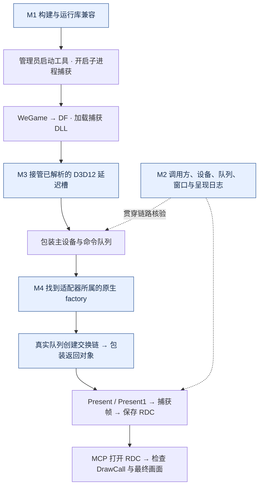

# DF 正式客户端截帧：成功链路

## 摘要

当前版本已完成 DF 正式客户端的 D3D12 截帧与回放验证：`zhou1.rdc` 第 **67589** 帧包含 **320 个 DrawCall、42 个 Dispatch**，最终输出确认为游戏主画面与 UI。

成功链路由两项核心改动接通：**接管主模块已解析的 D3D12 延迟导入槽**，使主设备进入包装；**桥接原生 DXGI factory**，将包装队列转换为真实队列创建交换链，再包装返回对象，接通 Present 与 RDC 捕获。

## 成功链路图

图中 **M1–M4** 为本轮改动，独立图源见 [DF_截帧完整链路.mmd](DF_截帧完整链路.mmd)。

## 关键改动

- **M1 构建兼容**：`Directory.Build.props` 默认统一 MSVC `14.44.35207`，启用 `_DISABLE_CONSTEXPR_MUTEX_CONSTRUCTOR`，兼容 WeGame 宿主已加载的旧运行库。
- **M2 链路诊断**：记录调用方、设备返回值、队列接口、交换链窗口及首次非 TEST Present，用于串联实际渲染对象。
- **M3 主设备包装**：`win32_hook.cpp` 的 `ProcessMainDelayImports` 处理主模块 D3D12/DXGI 已解析延迟槽；仅当目标精确匹配已加载库的已注册系统导出时，通过 `ApplyHook` 接入包装。
- **M4 交换链桥接**：`d3d12_hooks.cpp` 在设备创建成功后定位适配器所属 factory；`dxgi_wrapped.cpp` 桥接系统 DXGI 原生方法表的交换链创建调用，解包队列、调用原方法并包装返回交换链。移除钩子时恢复对应表项。

## 使用方式

1. 以管理员权限运行 `artifacts/graphics-factory-fix/x64/qTinecmaTool.exe`，开启子进程捕获。
2. 通过工具启动 WeGame，再从 WeGame 启动 DF，进入实际画面后执行帧捕获并保存 RDC。
3. 在 GUI 中打开 RDC，通过 MCP 检查绘制调用并导出最终画面。

## 已验证结果

- 文件：本地 `E:\GraphicsDebugger\zhou1.rdc`；API：D3D12；帧号：67589。
- 内容：320 个 DrawCall、42 个 Dispatch；最终 Present 为 EID 3311，输出 ResourceId 476；已重新打开并查看主画面。
- 证据、文件大小及 SHA-256 见 [验收记录](df_capture_verified_2026-10-15.json)。结论覆盖本次客户端与本机环境。

MCP 源码见 [integrations/renderdoc-mcp](../integrations/renderdoc-mcp/README.md)，安装配置见 [MCP 部署与使用](DF_RenderDoc_MCP_部署与使用.md)。
